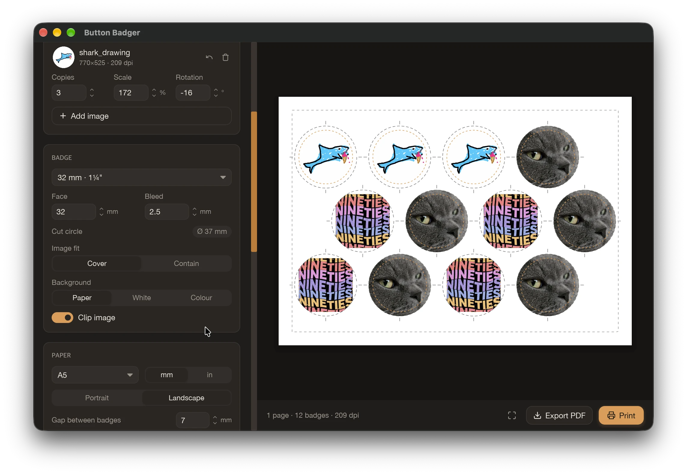

# Button Badger

  

Aligns images for printing button/badge templates to cut out in various configurations, with handy scissor lines and printer-scaling calibration. Vibe coded after having to edit and arrange things manually for the umpteenth time.

## Download

Grab the Mac, Windows or Linux build from [Releases](https://github.com/ronvoluted/button-badger/releases).

The Mac app isn't notarised, so the first launch is blocked: open it once, then allow it under System Settings → Privacy & Security → Open Anyway.

## Printing

Print opens your system's print dialog. Leave scaling at 100% (no "fit to page"), then use the calibration page if the rules don't measure true. On Linux the dialog comes from the desktop's print portal, so pick the paper size there; without a portal the PDF opens in your viewer instead.

## Shortcuts

| Key          | Action                              |
| ------------ | ----------------------------------- |
| Ctrl/⌘ & O   | Add images                          |
| Ctrl/⌘ & E   | Export PDF                          |
| Ctrl/⌘ & P   | Print                               |
| Ctrl/⌘ & 0   | Fit page                            |
| Ctrl/⌘ & +/− | Zoom                                |
| ← / →        | Previous / next page                |
| ↑ / ↓        | Step the focused number (⇧ for ×10) |
