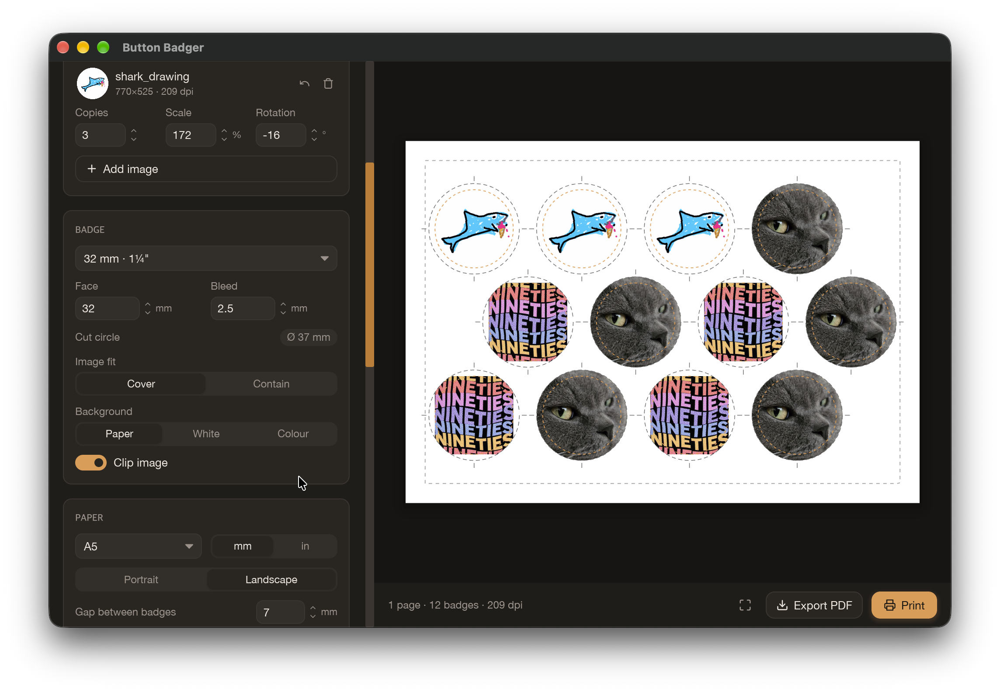

# Button Badger

  

Aligns images for printing button/badge templates to cut out in various configurations, with handy scissor lines and printer-scaling calibration. Vibe coded after having to edit and arrange things manually for the umpteenth time.

## Shortcuts

| Key                     | Action                              |
| ----------------------- | ----------------------------------- |
| Ctrl/⌘ + O              | Add images                          |
| Ctrl/⌘ + E              | Export PDF                          |
| Ctrl/⌘ + P              | Print                               |
| Ctrl/⌘ + 0              | Fit page                            |
| Ctrl/⌘ + + / Ctrl/⌘ + − | Zoom                                |
| ← / →                   | Previous / next page                |
| ↑ / ↓                   | Step the focused number (⇧ for ×10) |
